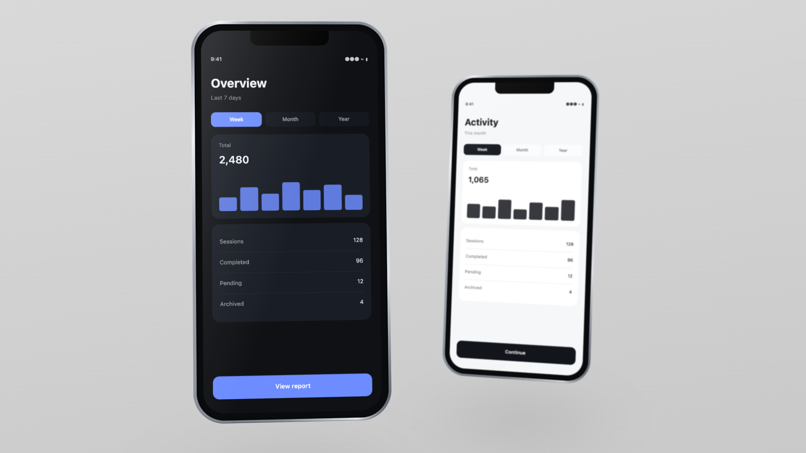

# Mockup Studio

Turn screen recordings into a floating 3D device mockup video — in the browser,
with live controls, and a one-click export to a real MP4.

Built because most mockup tools either produce stills, watermark the output, or
only let you put **one** device in a composition.



---

## What it does

- Two iPhone 13 mini mockups floating in a 3D scene, each playing its own footage
- Per-phone chassis colour, with the metal's highlight banding derived from it
- Deterministic drift, bob, tilt and roll — layered sines, not random jitter
- A depth "swap": one phone holds focus, then they trade places with real
  depth-of-field
- ~60 live controls, editable by slider or by typing exact values
- Exports a genuine MP4, frame by frame — not a screen recording

Device geometry is derived from the real hardware spec (131.5 × 64.2 mm body,
375 × 812 pt display, 44 pt corner radius), expressed as fractions of body width
so it stays correct at any scale.

## Requirements

- **Node 18+**
- **ffmpeg** on your `PATH` — `brew install ffmpeg`
- **Chromium** for the renderer — `npx playwright install chromium`
  (or set `CHROME_PATH=/path/to/chrome`)

## Getting started

```bash
npm install
node server.mjs
```

Open <http://localhost:5178>.

On first run the phones are empty. Hover a phone and click the **+** on its
screen to pick a recording, drag a file onto it, or use **Choose…** under
*Phone A / B → footage*. Videos (`mp4`, `mov`, `m4v`, `webm`) and stills
(`png`, `jpg`, `webp`, `gif`) both work.

Footage looks best at the iPhone's display aspect — 750 × 1624, 1080 × 2340, or
anything at 375 × 812 pt. Other aspects are cover-cropped to fit.

## Exporting

Press **Export video**. Progress, ETA and a cancel button appear in the panel;
the controls lock while it renders. Output lands in `out/` as
`mockup-YYYYMMDD-HHMMSS.mp4`, so exports never overwrite each other.

A CLI is available too:

```bash
node render.mjs                 # uses your current settings
node render.mjs --scale 2       # 2x supersample, downscaled — crisper edges
node render.mjs --at 6          # a single still at t=6s, for poster frames
node render.mjs --out hero.mp4 --fps 30 --duration 18
```

Roughly 4 minutes per 450 frames at `--scale 1`, ~10 minutes at `--scale 2`.

## Controls worth knowing

| Control | What it does |
| --- | --- |
| **Phone size / Zoom** | Base device width, and overall scene scale |
| **Phone A / B body** | Chassis colour, per phone. The metallic banding is derived from whatever you pick, so it stays convincing from near-black to near-white |
| **Perspective** | Lower is more dramatic. 2400 is a calm default |
| **Choreography** | The depth swap — Phone A leads until *Swap at*, then they trade |
| **Back blur** | Depth-of-field on whichever phone is behind |
| **Back tuck** | Pushes the receding phone outward so it doesn't hide behind the hero |
| **Phase offset** | Per-phone motion seed. **Keep A and B different** — matching seeds make both phones bob in lockstep, which reads as one rigid object |
| **Link A ↔ B motion** | Mirrors motion amounts while leaving position, phase and footage independent |
| **Trim in / Playback rate** | Where each recording starts and how fast it plays. ~0.9 reads better than 1.0 |

Every value field accepts typed input: decimals, clamped to range, Enter to
commit, Escape to revert, arrow keys to step (Shift for 10×). Each section has
its own `reset` on hover, alongside **Reset all**.

Drag the divider to resize the panel; double-click it to snap back.

Real iPhone 13 mini finishes, if you want them: Midnight `#1f2126`,
Starlight `#f2e8dc`, Blue `#2b4f77`, Pink `#e0c5c2`, Green `#4a5d52`,
Product RED `#a8202f`.

Keep motion amplitudes low. If a viewer notices the movement instead of the
interface, it's too much.

## How it works

The whole composition is a **pure function of time**. `render.mjs` drives
`MockupStudio.seek(t)` one frame at a time, screenshots the stage, and pipes PNGs
straight into ffmpeg. Every frame is composited at full quality — no dropped
frames, no compositor stutter, no cursor.

Two implementation notes that matter if you fork this:

**Screens draw to a `<canvas>`, not a `<video>`.** A `<video>` inside a 3D
transform gets promoted to a GPU overlay plane, which composites unreliably and
captures as *black* in headless screenshots. `drawImage()` is deterministic.

**Encoding avoids cloud-synced folders.** If the output path is inside an
iCloud-synced `~/Documents` or `~/Desktop`, ffmpeg's writes intermittently fail
with `Operation timed out` and kill the encode. The renderer detects this and
encodes to local disk first, then copies the result into place.

## Files

```
index.html       markup
style.css        app chrome + device geometry
app.js           state, generated controls, animation
server.mjs       static server, upload + export endpoints
render.mjs       headless frame renderer -> ffmpeg
config.json      local media paths (generated, not committed)
state.json       your settings (generated, not committed)
```

## Limitations

- The device is a **flat plane**, not a solid 3D body. There's no side rail with
  real thickness, so extreme yaw angles read as a card rather than an object.
- iPhone 13 mini only — no other devices, tablets or laptops yet.
- Exactly two phones per composition.
- Uploading copies the file into `media/`, since browsers can't hand a page a
  real filesystem path.

## Licence

MIT
